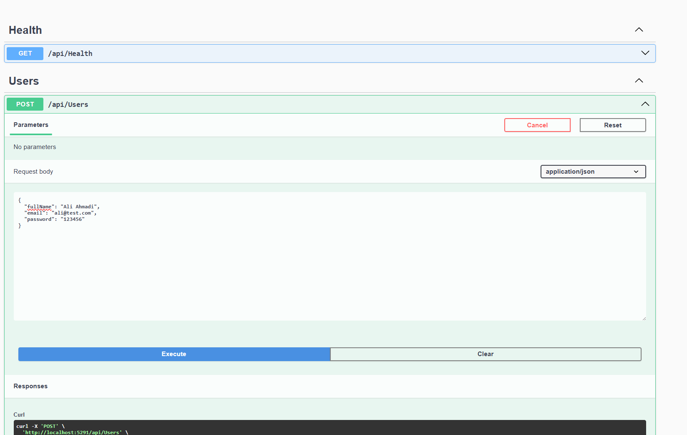
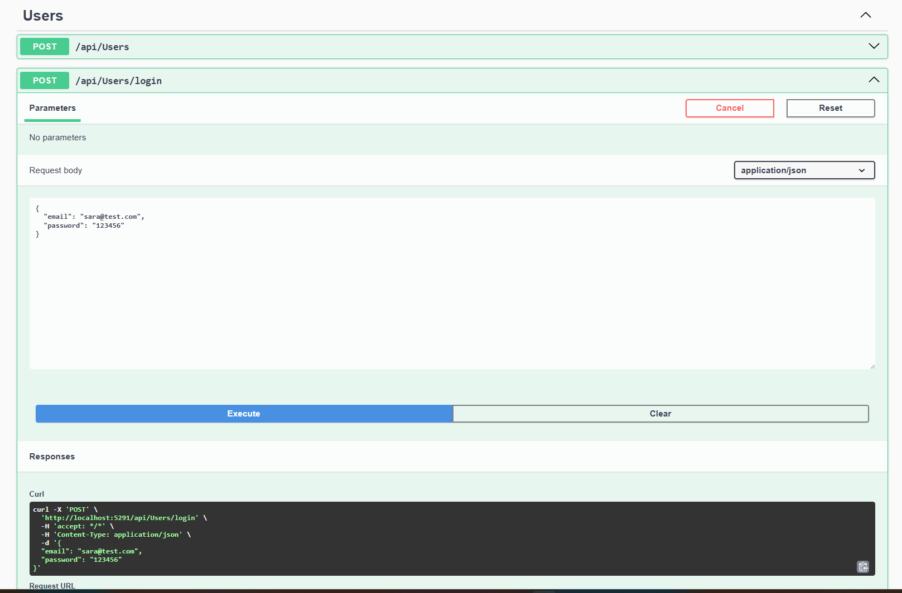
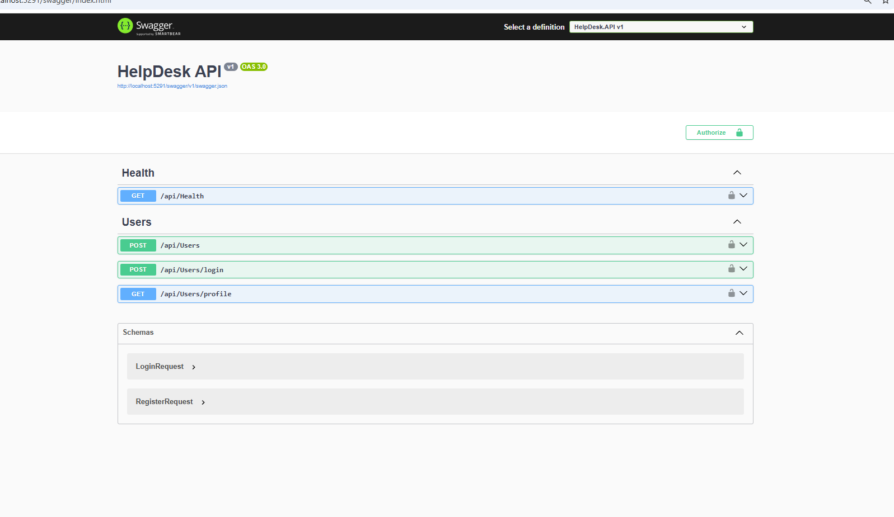
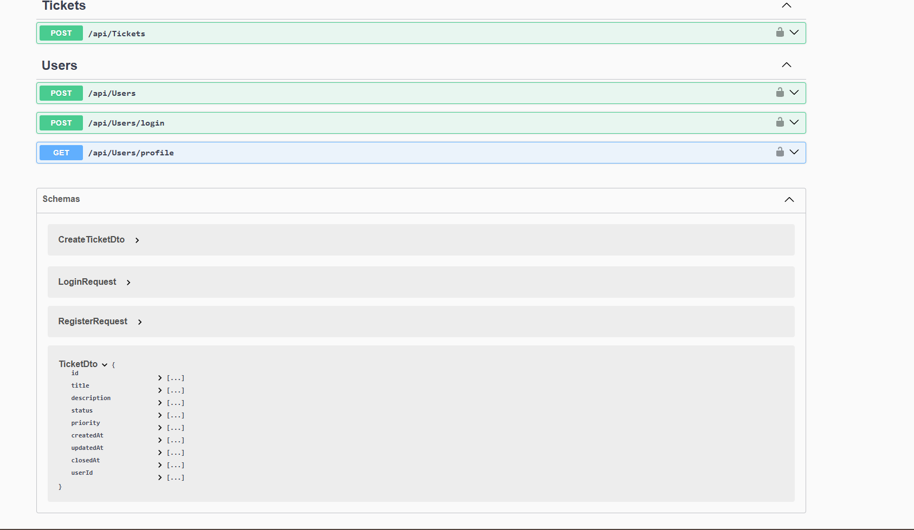
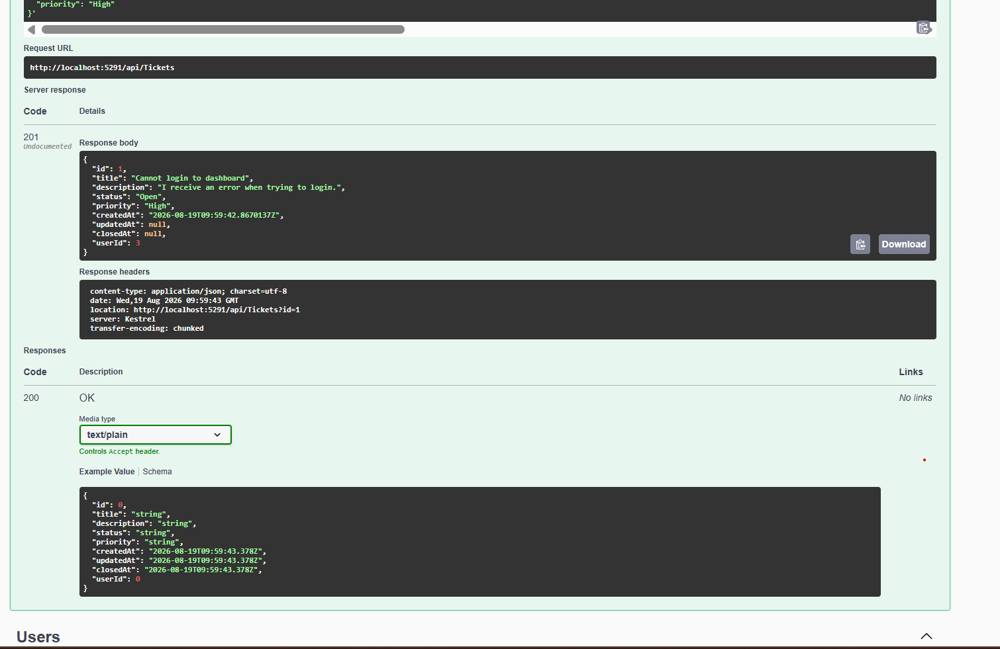
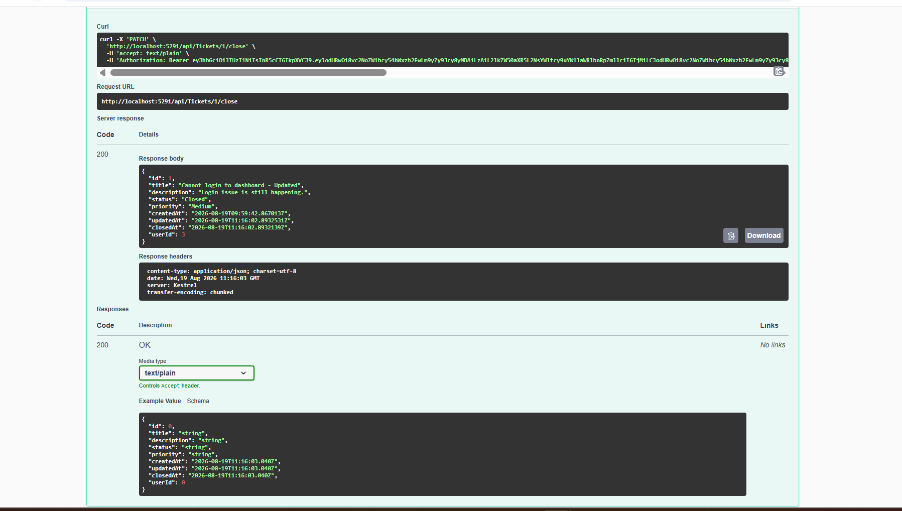
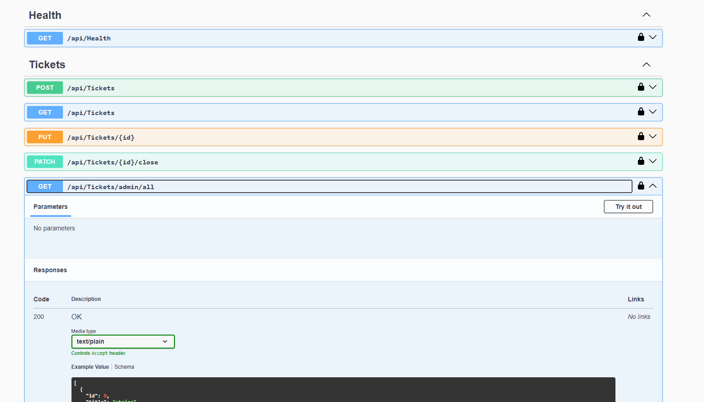
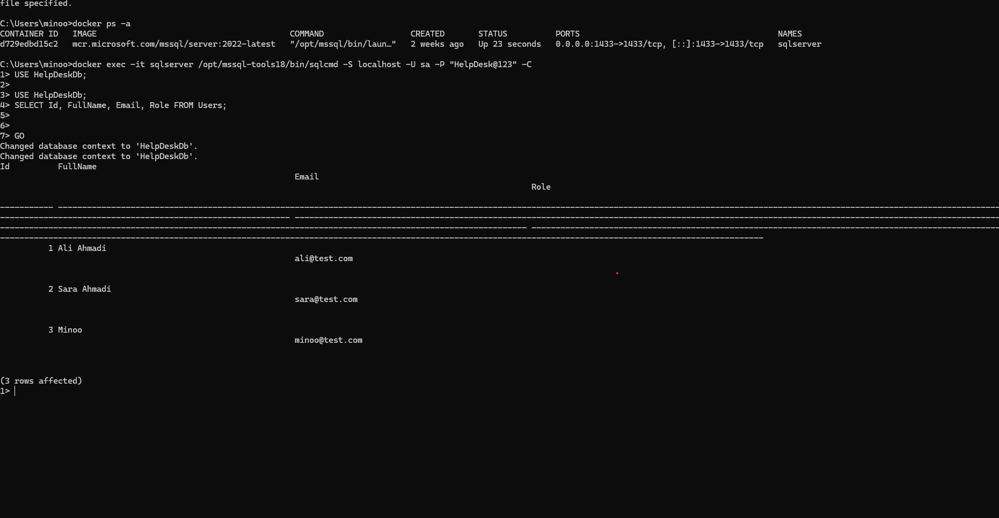
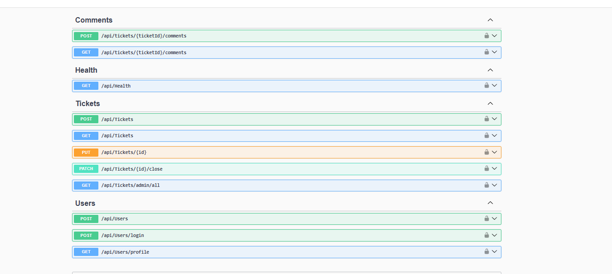

# 🎫 HelpDesk Ticket System

## ASP.NET Core 8 • SQL Server • Docker • JWT • n8n • Ollama • Local AI

<p align="center">


</p>

<p align="center">
<strong>
A backend HelpDesk platform combining secure REST API development,
relational database design, Docker, workflow automation and local AI.
</strong>
</p>

---

# 📖 About The Project

**HelpDesk Ticket System** is a backend-focused support ticket platform built with **ASP.NET Core 8 Web API**.

The project goes beyond basic CRUD operations.

It combines several backend engineering concepts in one system:

- REST API architecture
- User authentication
- Password security
- JWT authorization
- Role-based access control
- Resource ownership validation
- Relational database modeling
- Entity Framework Core
- SQL Server
- Docker
- Ticket lifecycle management
- Ticket comments
- Swagger/OpenAPI
- n8n workflow automation
- Webhooks
- Local LLM integration
- Ollama
- Llama 3.2 3B
- AI ticket classification
- AI-generated support responses

The goal was to build the project incrementally and solve the integration problems that appear when multiple backend technologies need to work together.

---

# 🏗️ System Architecture

The project currently contains two major parts.

## 1. HelpDesk Backend

```text
                 ┌──────────────────────┐
                 │        Client        │
                 │ Swagger / REST Client│
                 └──────────┬───────────┘
                            │
                            │ HTTP / JSON
                            ▼
                 ┌──────────────────────┐
                 │  ASP.NET Core 8 API  │
                 │                      │
                 │ Users                │
                 │ Tickets              │
                 │ Comments             │
                 │ Authentication       │
                 │ Authorization        │
                 └──────────┬───────────┘
                            │
                            ▼
                 ┌──────────────────────┐
                 │ Entity Framework     │
                 │ Core 8               │
                 └──────────┬───────────┘
                            │
                            ▼
                 ┌──────────────────────┐
                 │ SQL Server           │
                 │ Docker Container     │
                 └──────────────────────┘
```

## 2. AI Automation

```text
                 ┌──────────────────────┐
                 │   HelpDesk Ticket    │
                 │     JSON Payload     │
                 └──────────┬───────────┘
                            │
                            │ POST
                            ▼
                 ┌──────────────────────┐
                 │     n8n Webhook      │
                 └──────────┬───────────┘
                            │
                            ▼
                 ┌──────────────────────┐
                 │     Edit Fields      │
                 │ Normalize Input      │
                 └──────────┬───────────┘
                            │
                            ▼
                 ┌──────────────────────┐
                 │   Basic LLM Chain    │
                 └──────────┬───────────┘
                            │
                            ▼
                 ┌──────────────────────┐
                 │       Ollama         │
                 │   Llama 3.2 : 3B     │
                 │      Local LLM       │
                 └──────────┬───────────┘
                            │
                            ▼
                 ┌──────────────────────┐
                 │ AI Ticket Analysis   │
                 │                      │
                 │ Category             │
                 │ Priority             │
                 │ Suggested Response   │
                 └──────────┬───────────┘
                            │
                            ▼
                 ┌──────────────────────┐
                 │ Respond to Webhook   │
                 └──────────┬───────────┘
                            │
                            ▼
                       JSON Response
```

---

# ✨ Main Features

## 🔐 Authentication & Security

- ✅ User registration
- ✅ User login
- ✅ BCrypt password hashing
- ✅ JWT token generation
- ✅ JWT Bearer Authentication
- ✅ Protected API endpoints
- ✅ User identity stored in JWT claims
- ✅ Role claims
- ✅ User/Admin roles
- ✅ Role-Based Authorization
- ✅ Swagger JWT authorization
- ✅ Resource ownership validation

---

# 👤 User Registration

Users can create accounts through the API.

Passwords are never intended to be stored as plain text.

BCrypt is used to hash passwords before persistence.

<p align="center">
  
</p>

### Why BCrypt?

Authentication systems should never store raw passwords.

BCrypt provides password hashing and verification so that the database stores a hash instead of the user's original password.

---

# 🔑 Login & JWT Authentication

After successful authentication, the backend generates a JWT.

The token is then sent with protected requests using:

```text
Authorization: Bearer YOUR_JWT_TOKEN
```

<p align="center">
  
</p>

## JWT Authentication Flow

```text
Email + Password
       ↓
Find User
       ↓
BCrypt Password Verification
       ↓
Generate JWT
       ↓
Add Identity + Role Claims
       ↓
Return Token
       ↓
Bearer Authentication
       ↓
Protected API
```

### Why JWT?

JWT allows the API to use stateless authentication.

The server can validate the signed token on each request without requiring a traditional server-side session.

It also provides a convenient foundation for future:

- Frontend clients
- Mobile applications
- External API consumers
- Automation integrations

---

# 🛡️ Protected User Profile

Authenticated users can access protected endpoints using their JWT.

<p align="center">
  
</p>

Authentication proves **who the user is**.

Authorization determines **what that user is allowed to do**.

Both concepts are implemented separately in the project.

---

# 👥 Role-Based Authorization

The system supports two application roles:

```text
User
Admin
```

Regular users work with their own support tickets.

Administrators have broader access through protected Admin endpoints.

### Why Roles?

A real HelpDesk system needs different permission levels.

```text
User
 └── Manage own support resources

Admin
 └── Access broader HelpDesk operations
```

Role information is included in the authentication/authorization flow so protected endpoints can enforce the correct access level.

---

# 🎫 Ticket Management

Ticket management forms the core of the HelpDesk backend.

Implemented operations include:

- ✅ Create tickets
- ✅ Retrieve tickets
- ✅ Update tickets
- ✅ Close tickets
- ✅ Ticket status
- ✅ Ticket priority
- ✅ User/Ticket relationships
- ✅ Ownership checks
- ✅ Administrative ticket access

---

# 📝 Ticket Creation

A user can create a HelpDesk ticket containing support information such as:

```text
Title
Description
Priority
Status
User
Created Date
```

<p align="center">
  
</p>

---

# 📋 Ticket Retrieval

Authenticated users can retrieve tickets available to them.

<p align="center">
  
</p>

---

# ✏️ Ticket Update

Tickets can be updated as the support request progresses.

<p align="center">
  
</p>

---

# 🔒 Ticket Ownership Validation

JWT authentication alone is not sufficient for secure resource access.

For example, an authenticated user should not be able to change:

```text
/api/Tickets/5
```

to:

```text
/api/Tickets/6
```

and gain access to another user's ticket.

For this reason, the project also implements **resource ownership validation**.

Conceptually:

```text
Authenticated?
     ↓
Yes
     ↓
Owns Ticket?
 ┌───┴────┐
Yes       No
 ↓         ↓
Allow    Reject
```

This adds authorization at the resource level rather than relying only on authentication.

---

# 🔄 Ticket Lifecycle

Tickets can move through their lifecycle without being deleted.

Closing a ticket represents the completion of the support request while preserving historical data.

<p align="center">
  
</p>

### Why Close Instead of Delete?

HelpDesk tickets are historical records.

Deleting resolved tickets would remove useful information about:

- Previous incidents
- Support activity
- User history
- Resolution history

A status-based lifecycle is therefore more appropriate.

---

# 👨‍💼 Admin Ticket Management

Administrators can access ticket information beyond a regular user's own resources.

<p align="center">
  
</p>

This demonstrates:

```text
JWT Authentication
       +
Role Claims
       +
Role-Based Authorization
       +
Resource Access Rules
```

---

# 💬 Ticket Comments

Support tickets can contain comments.

This extends the project from simple ticket records into a basic support conversation model.

Implemented features:

- ✅ Add comments
- ✅ Retrieve ticket comments
- ✅ User-to-Comment relationship
- ✅ Ticket-to-Comment relationship
- ✅ Authorization checks
- ✅ Nested ticket/comment routes

Example route structure:

```text
POST /api/tickets/{ticketId}/comments
GET  /api/tickets/{ticketId}/comments
```

<p align="center">
  
</p>

---

# 🔗 Database Relationships

The core entities are related as follows:

```text
User
 │
 ├──────────────┐
 │              │
 ▼              ▼
Tickets       Comments
 │              │
 │              │
 └──────┬───────┘
        ▼
      Ticket
```

Another representation:

```text
User
 ├── Tickets
 └── TicketComments

Ticket
 ├── User
 └── TicketComments

TicketComment
 ├── User
 └── Ticket
```

Each ticket belongs to a user.

Each comment belongs to a ticket and a user.

---

# 🗄️ Entity Framework Core

Entity Framework Core is used as the ORM between ASP.NET Core and SQL Server.

Responsibilities include:

- Entity mapping
- DbContext management
- Relationships
- Foreign keys
- Queries
- Async persistence
- Migrations
- Database schema evolution

---

# 🔄 Database Migrations

The database schema evolved together with the project.

Migrations were required as functionality was added for:

```text
Initial Database
      ↓
Users
      ↓
Tickets
      ↓
Roles
      ↓
Ticket Comments
      ↓
Relationship Updates
```

### Why Migrations?

Migrations allow database changes to be:

- Versioned
- Repeatable
- Stored with source code
- Applied consistently
- Tracked throughout development

---

# ⚠️ SQL Server Relationship Challenge

Adding comments introduced multiple relationships between:

```text
User
Ticket
TicketComment
```

Relational databases can reject certain combinations of cascading deletes when multiple cascade paths could exist.

The relationship configuration therefore required explicit handling rather than relying only on default conventions.

This was an important database-design issue solved during development.

---

# 🐳 Docker & SQL Server

SQL Server runs inside Docker for the local development environment.

<p align="center">
  
</p>

### Why Docker?

Using Docker makes infrastructure easier to reproduce.

Instead of tightly coupling the project to one machine's SQL Server installation, the database environment can be managed as a container.

The project also uses Docker for n8n.

```text
Windows Host
│
├── ASP.NET Core
├── Ollama
│
└── Docker
    ├── SQL Server
    └── n8n
```

---

# ❤️ Health Check

The backend includes a health endpoint to verify that the API is running.

Example:

```http
GET /api/Health
```

A health endpoint is useful for:

- Development
- Deployment
- Container monitoring
- Load balancers
- Automated availability checks

---

# 📚 Swagger / OpenAPI

Swagger provides interactive API documentation and testing.

It was used throughout development for:

- Registration
- Login
- JWT authentication
- Protected routes
- Ticket creation
- Ticket retrieval
- Ticket updates
- Ticket closing
- Admin routes
- Comments
- Health checks

<p align="center">
  
</p>

---

# 🤖 AI-Powered HelpDesk Automation

The project was extended beyond the traditional backend with an AI automation layer.

The goal is to analyze incoming HelpDesk tickets and produce useful structured information automatically.

The AI workflow can return:

```text
Ticket Category
Ticket Priority
Suggested Support Response
```

---

# ⚙️ n8n Automation

n8n is used as the workflow orchestration layer.

The implemented workflow is:

```text
Webhook
   ↓
Edit Fields
   ↓
Basic LLM Chain
   ↓
Ollama Chat Model
   ↓
Respond to Webhook
```

<p align="center">
  
</p>

### Why n8n?

AI orchestration was separated from the core ASP.NET backend.

This makes it possible to modify the AI workflow without tightly coupling every automation step to application code.

n8n provides:

- Visual workflow design
- Webhooks
- JSON processing
- AI nodes
- Model integrations
- API integrations
- Workflow debugging
- Independent automation logic

---

# 🧠 Basic LLM Chain

The ticket information is sent to an LLM chain with instructions to analyze the support request.

The model is asked to produce information such as:

```json
{
  "category": "Login Issues",
  "priority": "High",
  "suggestedResponse": "..."
}
```

Structured output makes the AI result more useful to another application than unrestricted natural-language text.

---

# 🦙 Local AI with Ollama

Instead of depending on a paid cloud AI API, the final workflow uses **Ollama**.

The installed model is:

```text
llama3.2:3b
```

<p align="center">
  
</p>

### Why Ollama?

A cloud AI integration introduces:

- API credentials
- Usage quotas
- External dependency
- Per-request costs

For the local development version of this project, Ollama provides:

- ✅ Local inference
- ✅ No paid API credits required
- ✅ Local model execution
- ✅ Easy model experimentation
- ✅ Control over the runtime
- ✅ Provider independence at the workflow level

---

# 🔌 Connecting Dockerized n8n to Ollama

This integration introduced an important networking issue.

n8n runs inside Docker.

Ollama runs on the Windows host.

Inside a Docker container:

```text
localhost
```

means:

```text
the container itself
```

—not the Windows host.

The n8n Ollama connection therefore uses:

```text
http://host.docker.internal:11434
```

Conceptually:

```text
┌───────────────────────────────┐
│ Windows Host                  │
│                               │
│   Ollama                      │
│   localhost:11434             │
│        ▲                      │
│        │                      │
│ host.docker.internal:11434    │
│        │                      │
│   ┌────┴──────────────────┐   │
│   │ Docker               │   │
│   │                      │   │
│   │ n8n                  │   │
│   └──────────────────────┘   │
└───────────────────────────────┘
```

This solved communication between the Dockerized automation service and the host AI runtime.

---

# 🖼️ n8n / Ollama Configuration

<p align="center">
  
</p>

---

# 🧠 AI Prompt Design

The AI receives the relevant ticket information:

```text
Title
Description
Priority
```

and is instructed to analyze the HelpDesk request.

The expected logical result contains:

```text
category
priority
suggestedResponse
```

Example ticket:

```json
{
  "title": "Cannot login to dashboard",
  "description": "I receive an error when trying to login",
  "priority": "High"
}
```

Example AI response:

```json
{
  "category": "Login Issues",
  "priority": "High",
  "suggestedResponse": "Please check your username and password for accuracy and try logging in again."
}
```

---

# 🌐 n8n Webhook

The automation accepts HTTP POST requests.

During development, n8n provides a test webhook.

Production execution uses the published webhook.

Example production endpoint:

```text
POST /webhook/helpdesk-ticket
```

Example local request:

```bash
curl -X POST http://localhost:5678/webhook/helpdesk-ticket \
-H "Content-Type: application/json" \
-d '{
  "title": "Cannot login to dashboard",
  "description": "I receive an error when trying to login",
  "priority": "High"
}'
```

Example response:

```json
{
  "category": "Login Issues",
  "priority": "High",
  "suggestedResponse": "Please check your username and password for accuracy and try logging in again."
}
```

---

# 🔁 Test vs Production Webhooks

During n8n development two webhook modes were used.

### Test

```text
/webhook-test/helpdesk-ticket
```

The test webhook is registered while the workflow is listening for a test execution.

### Production

```text
/webhook/helpdesk-ticket
```

After publishing the workflow, the production endpoint can process requests without manually starting a test listener.

Understanding this distinction was necessary to successfully complete the end-to-end automation.

---

# 📤 Respond to Webhook

The final workflow node sends the AI result back to the original HTTP caller.

```text
Request
   ↓
n8n
   ↓
Ollama
   ↓
AI Result
   ↓
Respond to Webhook
   ↓
HTTP JSON Response
```

This turns the AI workflow into an HTTP-accessible automation service rather than only displaying the model output inside n8n.

---

# 🧪 End-to-End AI Test

The production workflow was tested using a real POST request.

Input:

```json
{
  "title": "Cannot login to dashboard",
  "description": "I receive an error when trying to login",
  "priority": "High"
}
```

Production output:

```json
{
  "category": "Login Issues",
  "priority": "High",
  "suggestedResponse": "Please check your username and password for accuracy and try logging in again."
}
```

This validates the complete AI path:

```text
HTTP Request
     ↓
n8n Production Webhook
     ↓
Ticket Mapping
     ↓
LLM Chain
     ↓
Ollama
     ↓
Llama 3.2 3B
     ↓
AI Analysis
     ↓
Webhook Response
     ↓
JSON
```

---

# 🛠️ Tech Stack

| Area                 | Technology                |
| -------------------- | ------------------------- |
| Backend              | ASP.NET Core 8 Web API    |
| Language             | C#                        |
| ORM                  | Entity Framework Core 8   |
| Database             | SQL Server                |
| Database Environment | Docker                    |
| Authentication       | JWT Bearer Authentication |
| Password Security    | BCrypt                    |
| Authorization        | Role-Based Authorization  |
| API Documentation    | Swagger / OpenAPI         |
| Automation           | n8n                       |
| AI Runtime           | Ollama                    |
| AI Model             | Llama 3.2 3B              |
| Integration          | REST / Webhooks / JSON    |
| Version Control      | Git                       |
| Repository Hosting   | GitHub                    |

---

# 📁 Project Structure

```text
HelpDeskTicketSystem
│
├── HelpDesk.API
│   │
│   ├── Controllers
│   │   ├── UsersController.cs
│   │   ├── TicketsController.cs
│   │   ├── CommentsController.cs
│   │   └── HealthController.cs
│   │
│   ├── Data
│   │   └── ApplicationDbContext.cs
│   │
│   ├── DTOs
│   │   └── Comments
│   │
│   ├── Models
│   │   ├── User.cs
│   │   ├── Ticket.cs
│   │   └── TicketComment.cs
│   │
│   ├── Services
│   │   └── JwtService.cs
│   │
│   └── Migrations
│
├── pic
│   ├── apiendpointadd.png
│   ├── fullscreen.png
│   ├── login.png
│   ├── userprofile.png
│   ├── sqlrun.png
│   ├── ticketadminall.png
│   ├── ticketdo.png
│   ├── ticketdo2.png
│   ├── ticketdo3.png
│   ├── ticketpatchdone.png
│   ├── ticketdoresponse1.png
│   ├── n8n-ai-workflow.png
│   ├── N8N+OLLA.png
│   └── n8n2png.png
│
└── README.md
```

---

# 📌 API Endpoints

## Users

| Method | Endpoint             | Purpose                         |
| ------ | -------------------- | ------------------------------- |
| POST   | `/api/Users`         | Register a user                 |
| POST   | `/api/Users/login`   | Login and generate JWT          |
| GET    | `/api/Users/profile` | Retrieve protected user profile |

## Tickets

| Method | Endpoint                  | Purpose                       |
| ------ | ------------------------- | ----------------------------- |
| POST   | `/api/Tickets`            | Create ticket                 |
| GET    | `/api/Tickets`            | Retrieve user's tickets       |
| PUT    | `/api/Tickets/{id}`       | Update ticket                 |
| PATCH  | `/api/Tickets/{id}/close` | Close ticket                  |
| GET    | `/api/Tickets/admin/all`  | Retrieve all tickets as Admin |

## Comments

| Method | Endpoint                           | Purpose           |
| ------ | ---------------------------------- | ----------------- |
| POST   | `/api/tickets/{ticketId}/comments` | Add comment       |
| GET    | `/api/tickets/{ticketId}/comments` | Retrieve comments |

## Health

| Method | Endpoint      | Purpose          |
| ------ | ------------- | ---------------- |
| GET    | `/api/Health` | API health check |

---

# 🧩 Engineering Decisions

## Why ASP.NET Core?

ASP.NET Core provides a strong foundation for building structured, secure and scalable REST APIs.

The project uses it to separate:

```text
Controllers
Models
DTOs
Services
Data Access
Authentication
Authorization
```

---

## Why DTOs?

Database entities and public API contracts serve different purposes.

DTOs provide control over:

- Accepted request data
- Returned response data
- Validation
- API evolution
- Exposure of internal properties

---

## Why SQL Server?

The HelpDesk domain contains strongly related data:

```text
Users
Tickets
Comments
```

A relational database is a natural fit for enforcing these relationships and maintaining data integrity.

---

## Why EF Core?

EF Core provides:

- LINQ queries
- Entity mapping
- Relationship configuration
- Change tracking
- Async persistence
- Migrations
- SQL Server integration

---

## Why JWT?

JWT provides stateless authentication and can carry identity and role claims between the client and API.

---

## Why BCrypt?

Passwords should not be recoverable from the database.

BCrypt hashes passwords before storage and supports secure password verification during login.

---

## Why Ownership Validation?

Being authenticated does not automatically mean a user should have access to every resource.

Ownership checks protect individual tickets from unauthorized access by other authenticated users.

---

## Why Role-Based Authorization?

Administrators require broader support capabilities than regular users.

Roles provide an explicit security boundary between these operations.

---

## Why Docker?

Docker makes infrastructure reproducible and isolates services such as SQL Server and n8n from the host development environment.

---

## Why n8n?

n8n provides a flexible automation layer where external integrations and AI workflows can evolve separately from the core backend.

---

## Why Ollama?

Ollama allows local model execution without depending on paid AI API credits during development.

It also demonstrates that the AI architecture can use a local model provider rather than being permanently coupled to a cloud vendor.

---

## Why JSON AI Output?

AI responses eventually need to be consumed by software.

Structured JSON such as:

```json
{
  "category": "...",
  "priority": "...",
  "suggestedResponse": "..."
}
```

is much easier for APIs, databases and future frontend applications to process than unrestricted natural-language output.

---

# 🧯 Problems Solved During Development

The project involved more than implementing successful paths.

Several integration and configuration issues had to be debugged.

## Authentication & Security

- JWT generation
- Bearer authentication
- JWT claims
- Role claims
- Swagger authorization
- User/Admin authorization
- Ticket ownership rules

## Entity Framework Core

- DbContext configuration
- Model relationships
- Foreign keys
- Migration generation
- Migration application
- Model snapshot synchronization

## SQL Server

- Relational schema design
- User/Ticket relationships
- Ticket/Comment relationships
- User/Comment relationships
- Multiple cascade-path restrictions

## Docker

- SQL Server container setup
- n8n container execution
- Local service connectivity
- Docker-to-host networking

## n8n

- Webhook configuration
- Ticket field mapping
- LLM chain configuration
- AI model connection
- Test webhook behavior
- Production webhook behavior
- Respond to Webhook configuration
- Workflow publishing

## AI

- External AI API quota limitation
- Moving the workflow to local AI
- Ollama installation
- Model download
- Llama 3.2 3B testing
- Prompt construction
- AI classification
- JSON output
- n8n/Ollama integration

---

# 📈 Development Journey

The project was developed incrementally rather than attempting to build everything at once.

```text
ASP.NET Core API
       ↓
SQL Server
       ↓
Entity Framework Core
       ↓
User Registration
       ↓
BCrypt Security
       ↓
Login
       ↓
JWT Authentication
       ↓
Protected Endpoints
       ↓
Ticket Model
       ↓
Ticket CRUD
       ↓
Ticket Ownership
       ↓
User/Admin Roles
       ↓
Admin Endpoints
       ↓
Ticket Comments
       ↓
Complex Relationships
       ↓
Docker Environment
       ↓
n8n
       ↓
Webhook Automation
       ↓
LLM Integration
       ↓
Local Ollama
       ↓
Llama 3.2 3B
       ↓
AI Ticket Analysis
       ↓
Production Webhook
       ↓
End-to-End AI Response
```

---

# 🧪 Tested Functionality

- ✅ API startup
- ✅ SQL Server connection
- ✅ EF Core migrations
- ✅ User registration
- ✅ BCrypt password handling
- ✅ User login
- ✅ JWT generation
- ✅ JWT protected endpoints
- ✅ Swagger Bearer authorization
- ✅ User role
- ✅ Admin role
- ✅ Ticket creation
- ✅ Ticket retrieval
- ✅ Ticket update
- ✅ Ticket closing
- ✅ Ticket ownership validation
- ✅ Admin ticket access
- ✅ Ticket comment creation
- ✅ Ticket comment retrieval
- ✅ Relationship persistence
- ✅ Health endpoint
- ✅ n8n startup
- ✅ n8n webhook input
- ✅ n8n field mapping
- ✅ Ollama installation
- ✅ Llama 3.2 3B execution
- ✅ Docker → Ollama communication
- ✅ LLM Chain
- ✅ AI ticket category
- ✅ AI priority result
- ✅ Suggested response generation
- ✅ JSON AI response
- ✅ Test webhook
- ✅ Production webhook
- ✅ Respond to Webhook
- ✅ End-to-end curl request

---

# 🚀 Getting Started

## 1. Clone Repository

```bash
git clone https://github.com/Minoo-YH/HelpDeskTicketSystem.git
cd HelpDeskTicketSystem/HelpDesk.API
```

## 2. Restore Packages

```bash
dotnet restore
```

## 3. Configure Database

Configure the SQL Server connection string in:

```text
appsettings.json
```

> Do not commit real passwords, JWT secrets or production credentials to Git.

## 4. Apply Migrations

```bash
dotnet ef database update
```

## 5. Run API

```bash
dotnet run
```

Open the Swagger URL displayed by ASP.NET Core.

---

# 🦙 Running Ollama

Download the local model:

```bash
ollama pull llama3.2:3b
```

Check installed models:

```bash
ollama list
```

Run the model directly:

```bash
ollama run llama3.2:3b
```

---

# ⚙️ Running n8n + Ollama

When n8n is running inside Docker and Ollama is running on the host machine, configure the Ollama Base URL as:

```text
http://host.docker.internal:11434
```

For the default local Ollama installation, an API key is not required.

---

# 🔐 Security Notes

Do not commit secrets to the repository.

Keep values such as these outside Git:

```text
Database Passwords
JWT Signing Keys
Production Connection Strings
API Keys
Private Credentials
```

For production environments, use proper secret management or environment variables.

---

# 🗺️ Project Roadmap

## Completed

- [x] ASP.NET Core 8 REST API
- [x] SQL Server
- [x] Dockerized database
- [x] Entity Framework Core
- [x] Database migrations
- [x] User registration
- [x] BCrypt password hashing
- [x] Login
- [x] JWT authentication
- [x] JWT claims
- [x] Protected endpoints
- [x] Swagger authorization
- [x] User/Admin roles
- [x] Role-Based Authorization
- [x] Ticket creation
- [x] Ticket retrieval
- [x] Ticket update
- [x] Ticket closing
- [x] Ticket priority/status
- [x] Ticket ownership
- [x] Admin ticket access
- [x] Ticket comments
- [x] User/Ticket relationships
- [x] User/Comment relationships
- [x] Ticket/Comment relationships
- [x] Health endpoint
- [x] n8n environment
- [x] n8n webhook
- [x] n8n field mapping
- [x] Basic LLM Chain
- [x] Ollama installation
- [x] Llama 3.2 3B
- [x] n8n/Ollama integration
- [x] Local AI ticket analysis
- [x] Category classification
- [x] Priority analysis
- [x] Suggested support response
- [x] JSON AI output
- [x] Respond to Webhook
- [x] Production n8n workflow
- [x] End-to-end AI webhook test

## Next

- [ ] Automatically call n8n after `POST /api/Tickets`
- [ ] Persist AI category in SQL Server
- [ ] Persist AI suggested priority
- [ ] Persist AI suggested response
- [ ] Add AI analysis fields to Ticket DTOs
- [ ] Automated unit tests
- [ ] Integration tests
- [ ] Centralized exception handling
- [ ] Structured logging
- [ ] Frontend dashboard
- [ ] Production deployment
- [ ] CI/CD pipeline

---

# ⚠️ Current Integration Boundary

The **ASP.NET Core HelpDesk API** and the **n8n/Ollama AI workflow** are both functional.

The n8n production webhook has been successfully tested independently.

The next integration step is:

```text
POST /api/Tickets
        ↓
ASP.NET Core
        ↓
Automatically call n8n
        ↓
Ollama AI Analysis
        ↓
Return / Persist AI Result
```

This direct automatic API-to-n8n trigger is intentionally listed as future work rather than being presented as already completed.

---

# 🎯 Skills Demonstrated

### Backend Engineering

```text
C#
ASP.NET Core 8
REST API Design
Controllers
DTOs
Dependency Injection
Async Programming
```

### Security

```text
BCrypt
JWT
Claims
Bearer Authentication
Role-Based Authorization
Resource Ownership
```

### Database

```text
SQL Server
Entity Framework Core
Relational Modeling
Foreign Keys
Migrations
Cascade Behavior
```

### DevOps / Infrastructure

```text
Docker
Containerized SQL Server
Containerized n8n
Host/Container Networking
Git
GitHub
```

### Automation

```text
n8n
Webhooks
JSON
Workflow Orchestration
HTTP Integration
```

### Applied AI

```text
Ollama
Llama 3.2 3B
Local LLM
Prompt Design
Ticket Classification
Structured AI Output
Suggested Responses
```

---

# 💡 Key Takeaway

This project demonstrates how a traditional backend system can gradually evolve into a larger engineering solution.

It combines:

```text
Backend Engineering
        +
Security
        +
Database Design
        +
Docker
        +
Automation
        +
Local AI
```

rather than treating each technology as an isolated demo.

---

# 👩‍💻 Author

## Minoo YH

Backend / .NET project with workflow automation and applied local AI.

---

# ⭐ Support

If you find this project useful or interesting, consider giving the repository a ⭐.
